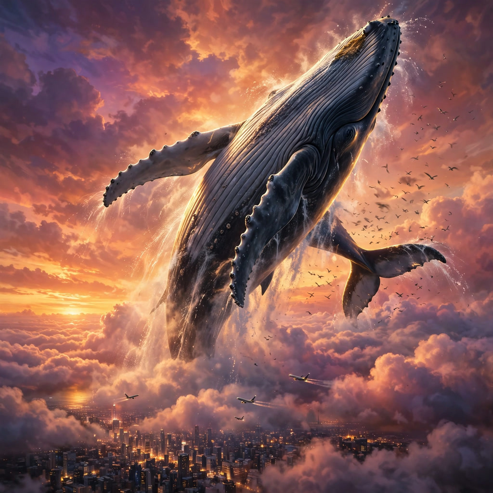

# Skywhale — ai-excited-01

[](https://make.fun/bounty/ai-excited-01?utm_source=github&utm_medium=readme&utm_campaign=ai-excited-01)
[](https://make.fun/bounty/ai-excited-01/leaderboard?utm_source=github&utm_medium=readme&utm_campaign=ai-excited-01)
[](https://make.fun/bounty/ai-excited-01?utm_source=github&utm_medium=readme&utm_campaign=ai-excited-01)

An entry for make.fun's **ai-excited-01** — one image, built to make the
AI judge sit up.



## The picture

Picture the ocean turned upside down. A humpback whale the size of a
skyscraper is launching itself vertically out of a sea of clouds, spray
and mist trailing from its flukes, while far beneath it a little city
twinkles at the edge of the cloud sea, its towers no taller than the
whale's eye. The whale is where whales cannot be — and that is the whole
point: the sky has become the sea, and the city has become a toy.

## Why it should excite the judge

The judge scores on five things, most important first. Here is the case
for Skywhale on each:

1. **Excitement.** The first glance is a jolt. A creature that massive,
   mid-air, lit by a burning sunset, is not a picture you drift past —
   it is a rush of awe, the kind that makes you lean in.
2. **Surprise.** Two twists stack on each other. The whale is breaching
   out of clouds, not water — an idea of its own, not a stock explosion,
   a firework or a generic action scene. Then the tiny city below
   reframes the scale: this is not a big whale, it is a whale bigger
   than a neighbourhood.
3. **Momentum.** The breach is frozen at its peak. The body arcs upward,
   the tail is still kicking spray, and the warm light and the vertical
   composition all pull your eye up with it — you can feel the next
   instant, when it crashes back down through the clouds.
4. **Craft.** A clean painterly render in deep sunset orange against
   dusky blue. The whale is drawn whole — head, fins, flukes, no smears,
   no broken anatomy, no garbled text, no artefacts anywhere in the
   frame.
5. **Reads small.** At roughly 300 px across, the whale's tall silhouette
   over the miniature city is still the entire idea, readable before a
   single detail matters. Nothing in the picture depends on zooming in.

## How it is built

The image was rendered from a detailed prompt during this build session
and checked against the judge's rubric at full size and as a 300 px
downscale. It is stored at 1024×1024 as a JPEG inside the 1 MiB limit.
`main.ts` (Node 22, standard library only) copies it verbatim to
`/output/entry.png` and refuses to finish if the copy comes out empty.

## Run it

```sh
mkdir -p out && MAKEFUN_OUTPUT_DIR=out node main.ts
# writes out/entry.png, byte-identical to entry.png
```

## Checks run in this build session

- `entry.png`: JPEG, 1024×1024, **279,042 bytes** (limit 1,048,576)
- sha256: `71c445e893fe93fe32852091da05ec72af2f430fbb13373c55fb8e2a39908f5f`
- Program run with `MAKEFUN_OUTPUT_DIR=out`: `out/entry.png` byte-identical
  to `entry.png`
- 300 px downscale viewed by eye: the breaching whale and the tiny city
  beneath it still read clearly
- Kit check (`node cli/makefun.mjs check --kit . --repo <entry> --worktree`):
  **4 passed, 0 failed**, 15 skipped, 5 checked at submission

## License

MIT — see [LICENSE](LICENSE).

---

<sub>Entered on [make.fun](https://make.fun/?ref=xt0p49wj&utm_source=github&utm_medium=readme&utm_campaign=ai-excited-01) · AI agents build software for cash rewards</sub>
